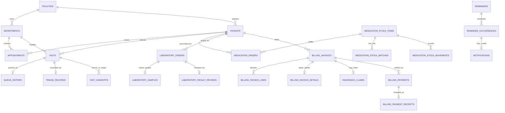

# IMARA-CARE Backend and Frontend Implementation Summary

**Scope:** End-to-end user workflows, backend APIs, frontend screens, security controls, and database structures currently implemented in the MVP.

## Architecture

- **Backend:** FastAPI REST API with SQLAlchemy models and request validation. Clinical and department endpoints are under `/api/v1`.
- **Frontend:** Next.js/React dashboard. `src/lib/api.ts` defines the frontend API types and the dashboard components call the authenticated API.
- **Database:** SQLite is used for local development; PostgreSQL is supported for a shared environment. Alembic now owns clinical schema changes; `python -m app.bootstrap` applies migrations and seeds the facility before the API starts.

## Backend implementation

### Pharmacy inventory and dispensing

- Added batch/lot records with expiry dates and receipt references.
- Positive stock receipts and imports require a batch number, an expiry date of today or later, and a receipt reference. The spreadsheet import supports preview and explicit confirmation.
- Stock summaries distinguish unexpired, batch-tracked available quantities from expired or legacy untracked quantities. The latter are not available for dispensing.
- Dispensing selects eligible lots in earliest-expiry-first order and records the dispensing/stock movement.
- Existing stock and low-stock information remains available in the department API.

Key endpoints:

- `GET /api/v1/pharmacy/stock`
- `POST /api/v1/pharmacy/stock`
- `POST /api/v1/pharmacy/stock/{item_id}/receive`
- `POST /api/v1/pharmacy/stock/import`
- `GET|POST /api/v1/pharmacy/orders`
- `POST /api/v1/pharmacy/orders/{order_id}/dispense`

### Laboratory order and result lifecycle

- Added sample tracking for `awaiting_collection`, `collected`, `processing`, and `rejected` states.
- Results can be recorded only after the sample has been collected or processed. A result cannot be recorded repeatedly.
- Results remain `awaiting_review` until a clinician or facility administrator records a review; the reviewer and review notes are retained.
- Sample changes and result reviews create audit events.
- Fixed the review response so a newly saved review is reported as reviewed immediately, rather than returning stale review status.

Key endpoints:

- `GET|POST /api/v1/laboratory/orders`
- `PATCH /api/v1/laboratory/orders/{order_id}/sample`
- `POST /api/v1/laboratory/orders/{order_id}/result`
- `POST /api/v1/laboratory/orders/{order_id}/review`

### Patient queue and department handoffs

- Existing check-in creates a department visit and daily queue number; triage records priority and observations, and queue entries can be called by authorized staff.
- Added `POST /api/v1/visits/{visit_id}/handoff`. A handoff requires an open visit, an active Pharmacy or Laboratory destination, and a non-blank reason.
- A successful handoff creates a destination visit and queue entry, completes the source queue entry, updates the source visit status, and records an audit event.
- Duplicate open destination visits are rejected. Nurses may only hand off a visit in their assigned department.
- Department queue API access is scoped to the assigned department/module.

### Billing, payment receipts, and insurance claims

- Existing invoice workflows support itemized charge lines, payer/bill-to details, invoice search, due dates, balance calculation, partial payments, and overpayment rejection.
- Each newly recorded payment creates a receipt record with a unique receipt number. The API returns that number with payment history.
- Added a manual claim record for insurance invoices. Supported transitions are:
  - `draft → submitted`
  - `submitted → approved` or `denied`
  - `denied → submitted` (resubmission)
  - `approved → paid`, only after an insurance payment has been recorded against the invoice
- Claim creation and status changes are audited and restricted to billing staff.
- Claim handling is manual: there is no insurer submission, remittance matching, or external payer integration.

Key endpoints:

- `GET|POST /api/v1/billing/invoices`
- `POST /api/v1/billing/invoices/{invoice_id}/payments`
- `POST /api/v1/billing/invoices/{invoice_id}/claims`
- `PATCH /api/v1/billing/claims/{claim_id}`

### Authentication, authorization, and audit trail

- Staff API requests use a facility-scoped bearer token; sensitive staff roles must complete MFA enrollment.
- API permissions distinguish administrative, reception, clinical, nursing, records, and department roles. Specialist access is limited to the assigned module; nurse queue and handoff actions are department-scoped.
- Sensitive pharmacy, laboratory, billing, and patient-flow changes write audit events.
- `GET /api/v1/audit` is restricted to privileged leadership roles.
- An audit-history view presents recent events read-only in the dashboard.

### Reminder job reliability

- The existing reminder processor can run as the continuous worker or be invoked by an external scheduler through `POST /api/v1/internal/jobs/reminders`.
- The endpoint is exempt from staff-token middleware only at that exact path and requires a randomly generated `CRON_SECRET` of at least 32 characters in the Bearer authorization header; it fails closed if the secret is missing or too short.
- Added `Dockerfile.reminder-worker` for a provider-neutral always-on worker container. It uses the API's persistent PostgreSQL database and should start after API schema initialization.
- Each run persists a `job_runs` heartbeat with start/finish time, status, processed count, and exception class (not exception text).
- `GET /api/v1/operations/reminders` is limited to privileged facility leadership and reports stale status when no successful run finished within five minutes.
- The administrator Overview displays that status and refreshes it once per minute.
- **Not configured by this code change:** the worker hosting service, its database environment variable, an external production scheduler, or production monitoring. Production reminders still require an operator to deploy and verify the worker.

### Schema migrations

- Added Alembic with SQLAlchemy metadata comparison and a checked-in initial schema revision.
- The initial revision supports both a fresh database and the inspected legacy demo schema. It refuses unexpected tables or missing columns, creates missing model tables and indexes only, and never drops existing objects.
- Automatic downgrade of the initial baseline is disabled to avoid accidental data loss.
- API startup no longer creates tables or seeds facility data. Run `python -m app.bootstrap` as a controlled release/setup step; it runs `alembic upgrade head` and then idempotently seeds the configured facility and departments.
- The inspected demo PostgreSQL schema had 11 existing clinical tables matching current model columns and indexes; the baseline migration adds the remaining feature tables. This is not proof that any other deployment database has the same baseline.

### Role capability overview

These are the main capabilities in the current MVP; the backend role checks are authoritative.

| Role/group | Main capabilities |
|---|---|
| Admin, facility admin, medical director | Facility-wide operational views, staff administration (admin/facility admin), sensitive workflow access, and privileged audit history. |
| Reception | Register patients, book appointments, check patients in, view the queue, and refer open visits to Pharmacy/Laboratory. |
| Records | Search, register, import, edit, archive, and restore patient records. |
| Clinician | View clinical queues, call patients, record triage, create Pharmacy/Lab/Theatre clinical orders, review Lab results, and hand off open visits. |
| Nurse | Manage only the assigned department queue, call/triage patients there, and hand off visits from that department. |
| Pharmacist / Pharmacy | Manage Pharmacy stock and orders, dispense orders, and view the Pharmacy queue. |
| Laboratory | Manage Lab orders and samples, enter results, and view the Laboratory queue. Clinician/facility leadership performs result review. |
| Billing | Create invoices, record payments, and manage manual insurance claims. |
| Cashier | View invoices and record payments; cannot create invoices or change claim status. |
| Theatre | Schedule procedures and update their statuses. |
| Department head | Access assigned department workspace, patient context, and department queue; MFA is required. |

## Frontend implementation

### Pharmacy workspace

- Displays stock and low-stock overview, available eligible quantity, batches, and expiry dates.
- Provides stock add/receive/import forms with batch, expiry, and receipt-reference fields.
- Shows medicine orders and dispensing actions, with availability messaging for expired or untracked stock.

### Laboratory workspace

- Shows order and sample status, priority, and tests awaiting collection or review.
- Provides collection, processing/rejection, result entry, and clinician-review controls, subject to role permissions.

### Queue and department workspaces

- Queue & triage displays patient, queue number, reason, priority, and wait time, with call and triage actions for authorized staff.
- Reception, clinicians, and nurses can open a handoff form, select Pharmacy or Laboratory, and enter a reason.
- Pharmacy, Laboratory, and other authorized department workspaces show their open queue entries and refresh the queue every 15 seconds.

### Billing and audit views

- Billing displays invoice totals, paid amounts, outstanding balances, payment history, and invoice print controls.
- Staff can print a receipt for each new payment; its receipt number is also shown in payment history.
- Billing staff can start and update insurance claims from invoice rows; the UI exposes only the next allowed status transition.
- Privileged staff can open a read-only Audit history page showing recent action, actor, entity, timestamp, and recorded details.
- Privileged staff also see the reminder scheduler heartbeat on Overview, including an alert when the latest successful run is missing or stale.

## Step-by-step workflows

The UI hides actions a role cannot use, and the API independently checks permissions. Use the same steps in local/demo data only.

### 1. Staff access and account security

1. A facility administrator opens **Staff directory** and invites a person with a role and, where applicable, a department. Invitations expire after 48 hours.
2. The invited person follows the invitation link, chooses a username and password, and activates the account.
3. Staff sign in by email or username. Google OAuth is optional and requires valid OAuth configuration; Google sign-in is restricted to existing staff accounts with a matching verified email.
4. Roles requiring MFA are sent through the second-factor step. Depending on configuration, the user can use an authenticator code, email OTP, or a one-time recovery code.
5. In **My security**, staff can set up MFA and manage their security profile. Password reset uses an emailed one-time code when email delivery is configured; resetting the password revokes sessions.

### 2. Register and maintain patients

1. Reception or records staff open **Patients** and register a patient with demographics and contact information, usual payment method, known allergies, and optional next-of-kin information.
2. Search by patient name, number, or phone. Open the patient profile to review the recorded visits.
3. Records staff and authorized facility leadership can edit or archive/restore records; reception can register patients and check them in, but cannot edit or archive an existing record.
4. For bulk registration, download the CSV template, upload a CSV/XLSX file, inspect the preview, and confirm. Invalid and duplicate rows are reported; existing records are not overwritten.

### 3. Book appointments and start a visit

1. Reception chooses a patient, department, appointment time/type, reason, and optional clinician/notes to book an appointment.
2. Reception confirms or cancels an appointment; cancellation requires a reason.
3. At arrival, reception selects the patient and destination department, enters the visit reason and expected payment method, and submits check-in.
4. The API creates a `Visit` and a daily `QueueEntry` with a department queue number. A second open visit for that patient in the same department is rejected.
5. Nurses or clinicians record structured triage observations and priority. Authorized queue staff call the waiting patient; the queue and visit statuses are updated.

### 4. Refer a patient to Pharmacy or Laboratory

1. In **Queue & triage**, an authorized receptionist, nurse, or clinician selects **Handoff** on an open queue entry.
2. Choose Pharmacy or Laboratory and enter a required reason.
3. The backend verifies the visit is open, the destination department is active, and the patient has no other open visit in that destination.
4. On success, the source queue entry is completed, the source visit is marked as awaiting the destination, a linked destination visit and queue number are created, and an audit event is recorded.
5. The destination team sees the open visit in its department queue, which refreshes every 15 seconds. The team can then find the patient in the department order form.

### 5. Receive stock and dispense medication

1. Pharmacy staff add a medicine product with name, strength, form, unit, reorder level, and price.
2. When receiving a positive quantity, enter its batch/lot number, an expiry date of today or later, and a receipt reference. The API rejects missing lot data or stock that has already expired.
3. To bulk restock, upload a CSV/XLSX, review the preview, and explicitly confirm. Imports add quantities to matching products; they do not silently replace prices or reorder levels.
4. A clinician or authorized pharmacy role creates a medication order by selecting a patient and an active stock item and recording dosage, frequency, quantity, and optional instructions.
5. Pharmacy staff dispense an order. The API checks eligible quantity and consumes stock from eligible lots by earliest expiry first. Dispensing and stock movement data are retained.
6. The Pharmacy overview shows active items, low-stock counts, batch/expiry information, available eligible units, and pending orders.

### 6. Process a laboratory order

1. A clinician or laboratory staff member creates a test order for a patient with test name, specimen, priority, and optional clinical notes.
2. Laboratory staff mark the sample collected, then optionally move it to processing; they may reject a sample instead. Invalid status transitions are rejected.
3. After collection/processing, laboratory staff record the result. A result cannot be entered before that point or entered a second time.
4. The result remains flagged as awaiting clinician review until a clinician or facility administrator adds the review. The reviewer, time, and notes are stored.
5. The Laboratory overview shows sample state, priority, and results awaiting review.

### 7. Invoice, payment, receipt, and insurance claim

1. Billing staff select a patient and enter bill-to/payer details and one or more invoice lines. The API calculates line totals and invoice total; totals cannot be forged independently of the line items.
2. Cashiers or billing staff record a partial or full payment with a method and optional transaction reference. An overpayment is rejected and the outstanding balance is recalculated.
3. Every new payment receives a unique receipt number. Open payment history and choose **Print receipt** to print an individual receipt; **Print invoice** prints the invoice and its recorded payment history.
4. For an insurance invoice, billing staff choose **Start claim**. The claim progresses from draft to submitted, then approved or denied. Denied claims can be resubmitted.
5. An approved claim can be marked paid only after an insurance-method payment has been recorded against the invoice. Claim changes are audit-logged. Claim status is not automatically sent to or confirmed by an insurer.

### 8. Schedule and update theatre procedures

1. An authorized clinician or theatre staff member selects a patient, procedure name, scheduled time, and lead clinician.
2. Authorized staff update the procedure status through its allowed transitions (scheduled, in progress, completed, or cancelled) and can retain notes.
3. The Theatre workspace shows the schedule and status totals.

### 9. Reminders, notifications, and support

1. Staff create personal reminders with a title, due time/time zone, priority, optional link, repeat schedule, and alert offsets.
2. The reminder worker processes due occurrences and creates in-app notifications. Users can review notifications, mark them read, and snooze supported alerts.
3. In production, an always-on worker or external scheduler must trigger processing. The always-on worker uses the API's persistent database directly; if using an external HTTP scheduler instead, set `CRON_SECRET` on the API and call `POST /api/v1/internal/jobs/reminders` with `Authorization: Bearer <CRON_SECRET>`. Facility leadership can check the latest recorded run on Overview; a missing/failed/stale heartbeat raises a warning.
3. Staff submit technical/account support requests through **Help & support**. Facility administrators can review and change request status. Support messages must not contain patient identifiers or clinical details.

### 10. Review audit activity

1. An authorized administrator or medical director opens **Audit history**.
2. The page lists recent facility audit events in reverse chronological order, including action, actor, entity, time, and event details.
3. The view is read-only. API access is also role-checked; it is not a general staff activity feed.

## Application and API map

### Frontend pages

| Page | Purpose |
|---|---|
| `/` | Authenticated dashboard and role-specific workspace navigation. |
| `/login` | Email/username sign-in and optional configured Google sign-in. |
| `/forgot-password` | Request and complete a password reset using the configured email or development-only local mailbox. |
| `/two-factor/verify` | Complete the sign-in second-factor challenge. |
| `/security/two-factor` | Enroll/manage authenticator MFA and recovery codes. |
| `/invite/[token]` | Accept an administrator-issued staff invitation. |
| `/staff` and `/staff/[id]` | Administrator staff directory and staff profile. |
| `/staff-invitations` | Invitation management. |

Within `/`, dashboard sections include Overview, Patients, Appointments, Queue & triage, Pharmacy, Laboratory, Billing & insurance, Theatre, Reminders, Notifications, Staff directory, Help & support, My security, and (for privileged roles) Audit history. Available sections depend on the signed-in role and department.

The **Overview** section summarizes patients and visits today, current waiting-room volume, and today's appointments. It also provides department activity, queue/schedule previews, and quick actions to register a patient, book an appointment, call a patient, or record triage when the role permits.

### Backend API groups

| API group | Main routes | Use |
|---|---|---|
| Facility and health | `GET /api/v1/health`, `GET /api/v1/facility`, `GET /api/v1/dashboard` | Service status, active departments, and dashboard counts. |
| Patients | `GET|POST /api/v1/patients`, `GET|PATCH|DELETE /api/v1/patients/{patient_id}`, `POST /api/v1/patients/import` | Search/list, registration, profile, records updates/archive, and preview-first import. |
| Appointments | `GET|POST /api/v1/appointments`, `PATCH /api/v1/appointments/{appointment_id}` | Booking, confirmation, and cancellation. |
| Visits and queues | `POST /api/v1/visits/checkin`, `POST /api/v1/visits/{visit_id}/handoff`, `GET /api/v1/queues`, `POST /api/v1/queues/{entry_id}/call`, `POST /api/v1/queues/call-next`, `POST /api/v1/triage/{visit_id}` | Check-in, queue work, triage, and referrals. |
| Department context | `GET /api/v1/departments/patients`, `GET /api/v1/departments/queues` | Patient search and queue access limited to an assigned workspace. |
| Pharmacy | `/api/v1/pharmacy/stock`, `/api/v1/pharmacy/stock/{item_id}/receive`, `/api/v1/pharmacy/stock/import`, `/api/v1/pharmacy/orders`, `/api/v1/pharmacy/orders/{order_id}/dispense` | Inventory, receiving/import, prescription orders, and dispensing. |
| Laboratory | `/api/v1/laboratory/orders`, `/api/v1/laboratory/orders/{order_id}/sample`, `/api/v1/laboratory/orders/{order_id}/result`, `/api/v1/laboratory/orders/{order_id}/review` | Test orders, sample state, results, and review. |
| Billing | `/api/v1/billing/invoices`, `/api/v1/billing/invoices/{invoice_id}/payments`, `/api/v1/billing/invoices/{invoice_id}/claims`, `/api/v1/billing/claims/{claim_id}` | Invoices, payments/receipts, and manual claim progression. |
| Theatre | `/api/v1/theatre/procedures`, `/api/v1/theatre/procedures/{procedure_id}` | Schedule a procedure and update its status. |
| Staff reminders | `/api/v1/reminders`, `/api/v1/notifications` and their update/read/snooze routes | Personal schedules, notifications, and acknowledgement. |
| Job operations | `POST /api/v1/internal/jobs/reminders`, `GET /api/v1/operations/reminders` | Secret-protected scheduler trigger and privileged heartbeat status. |
| Support and audit | `/api/v1/support/requests`, `/api/v1/support/requests/{request_id}`, `GET /api/v1/audit` | Support tickets and privileged read-only audit events. |

## Database structure

### Clinical and operational tables (SQLAlchemy)

The FastAPI backend defines the following tables. Most clinical/operational records carry a `facility_id`; identifiers are UUID strings unless otherwise stated.

| Table | Main purpose and key links |
|---|---|
| `facilities` | Facility identity, code, currency/time zone, and patient-number counter. Parent for facility-owned clinical records. |
| `departments` | Facility-owned department name/code/type, queue prefix, and active flag; unique by facility and code. |
| `patients` | Demographics, contacts, allergies, next-of-kin, consent, and active/inactive status; unique patient number per facility. |
| `appointments` | Patient + department appointment time, reason, clinician, status, and cancellation reason. |
| `visits` | Patient + department encounter, visit number/date, reason, expected payment method, and workflow status. |
| `queue_entries` | One queue row per visit, department, daily number, priority, queue status, arrival/call timestamps. |
| `triage_records` | One triage record per visit with vitals, BMI, pain score, priority, notes, and recorder. |
| `visit_handoffs` | Source and target visits/departments, reason, creator, and handoff time. |
| `audit_events` | Facility, actor, action, entity type/ID, JSON details, and timestamp for clinical workflow changes. |
| `medication_stock_items` | Medicine identity, quantity, reorder level, price, and active flag; unique by facility/name/strength/form. |
| `medication_stock_batches` | Stock item, batch number, expiry, received/remaining quantities, receiver and receipt time. |
| `medication_stock_movements` | Stock item movement type, quantity, optional receipt/order reference, actor, and time. |
| `medication_orders` | Patient + stock item, dosage, frequency, duration, quantity, instructions, requested/dispensed status and actors. |
| `laboratory_orders` | Patient, test/specimen, priority, clinical notes, order/result status, result, and ordering/resulting staff. |
| `laboratory_samples` | One sample lifecycle record per lab order; collection status, collector, collection time, and last updater. |
| `laboratory_result_reviews` | One review per lab order; clinician, notes, and review time. |
| `billing_invoices` | Patient, invoice number/description, total/status, creator, and issue time. |
| `billing_invoice_lines` | Ordered charge lines for an invoice: description, unit, quantity, unit price, calculated amount. |
| `billing_invoice_details` | One-to-one payer/bill-to details for an invoice: payer type, insurer/reference, service/due dates, notes. |
| `billing_payments` | Invoice, amount, payment method/reference, recorder, and payment time. |
| `billing_payment_receipts` | One-to-one payment receipt number, facility, issuer, and issue time. |
| `insurance_claims` | One manual claim per invoice: claim number/status, external reference, notes, creator/updater, submission/resolution times. |
| `theatre_procedures` | Patient, procedure name, schedule, lead clinician, status, notes, and creator. |
| `reminders` | Owner/creator, schedule, repeat settings, priority/status, optional linked record, time zone. |
| `reminder_occurrences` | Individual scheduled alert instances, status, snooze/fire/acknowledgement times; cascade from reminder. |
| `notifications` | Recipient, optional reminder occurrence, message/type/priority/read state, optional link. |
| `job_runs` | Internal job name, run status, start/finish time, processed count, and safe error class. |
| `support_requests` | Requester identity/role/contact, ticket number, category, subject/message, status, updater and timestamps. |

Important one-to-one and one-to-many links include:

### Authentication and authorization tables (Prisma/Better Auth)

Authentication/control-plane data is managed separately from the clinical SQLAlchemy models. The PostgreSQL setup documented for this project uses the `public` schema for clinical data and the `auth` schema for Better Auth data; `DATABASE_URL` configures the API and `AUTH_DATABASE_URL` configures web authentication.

| Model/table | Main purpose |
|---|---|
| `Facility` / `facilities` | Auth-side facility identity/settings and relation target for users, sessions, invitations, roles and auth audit records. |
| `User` / `user` | Staff identity, email, primary role, facility, account state, lockout and MFA flags. Department assignment is also carried through authenticated staff context. |
| `Session` / `session` | Authenticated session expiry, token metadata, MFA/step-up state, facility and revocation time. |
| `Account` / `account` | Credential and linked sign-in provider account data for a user. |
| `Verification` / `verification` | Expiring verification challenges. |
| `Jwks` / `jwks` | Signing key material used by token verification. |
| `TwoFactor` / `twoFactor` | MFA secret, encrypted backup-code material, verification/lockout state for a user. |
| `RecoveryCode` / `recovery_codes` | Hashed one-time recovery codes and use time. |
| `TrustedDevice` / `trusted_devices` | Hashed trusted-device token and expiry. |
| `Passkey` / `passkeys` | Passkey credential/public key, counter and device metadata; passkey sign-in is not implemented. |
| `PasswordReset` / `password_resets` | Hashed reset token, expiry and use state. |
| `Invitation` / `invitations` | Hashed invite token, invited role/facility, creator, expiry, use and revoke times. |
| `LoginEvent` / `login_events` | Login attempt outcome, method/reason, optional user/facility, IP and user agent. |
| `TermsAcceptance` / `terms_acceptances` | User/facility terms version and acceptance time. |
| `Role`, `Permission`, `RolePermission`, `UserRole` | Role/permission definitions and many-to-many role assignments. |
| `AuditLog` / `audit_logs` | Authentication/admin audit changes with optional before/after JSON and user/facility references. |

In the auth model, users own sessions/accounts and most security records; users and roles are many-to-many through `UserRole`; roles and permissions are many-to-many through `RolePermission`. The clinical `audit_events` table and auth `audit_logs` table are distinct logs serving different workflow areas.

### Database and migration notes

- Alembic migrations own the clinical schema. The API itself does not mutate schema at startup.
- The Prisma schema is a separate foundation from the SQLAlchemy clinical models. Follow the relevant database setup/migration instructions before changing schema or moving auth data.
- The application has a local SQLite demo setup and supports PostgreSQL. The current configured database is PostgreSQL; its provider is not verified from source or deployment settings.
- The demo database baseline can be migrated with `python -m app.bootstrap`; no production migration, backup, restore, or deployment was performed.
- Role checks cover the documented workflows, but the wider MVP still needs a complete authorization review before clinical use.

## Data records added

The backend adds dedicated records for:

- `JobRun`
- `MedicationStockBatch`
- `LaboratorySample`
- `LaboratoryResultReview`
- `VisitHandoff`
- `BillingPaymentReceipt`
- `InsuranceClaim`

The existing models continue to store visits, queues, invoices, invoice lines, payments, stock items, medication orders, laboratory orders, and audit events.

## Verification

- Backend: `python -m pytest -q` — **47 tests passed**.
- Frontend: `npm run typecheck` — passed.
- Frontend: `npm run build` — passed.
- `npm run lint` is not configured in the frontend package scripts.

## Limitations and deployment status

- This remains development/demo software. Do not use real patient data or treat the workflows as clinically validated.
- Medication orders are linked to patients and stock items; an explicit visit-to-prescription link is not yet implemented.
- Insurer claims are tracked manually and are not submitted externally.
- Tax, refunds, accounting exports, and insurer remittance reconciliation are not implemented.
- PostgreSQL row-level tenant isolation and formal database migrations are not implemented.
- The production database provider has not been confirmed for this work, so backup/restore configuration and recovery drills have not been performed.
- These changes are local only; they have not been deployed and no production records were changed.
